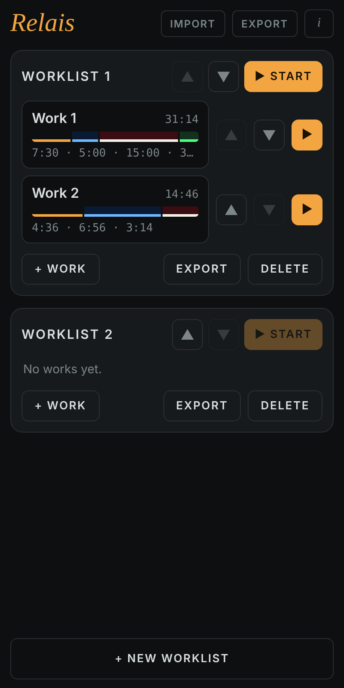
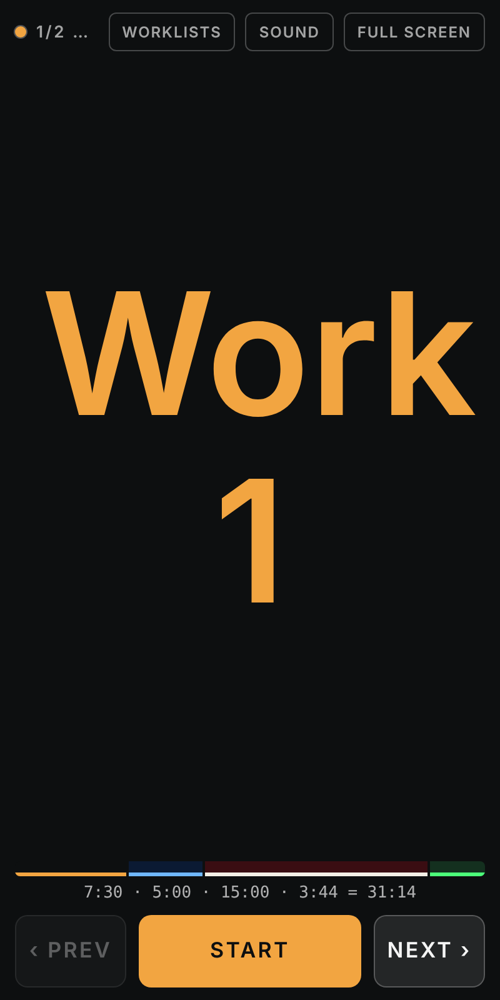
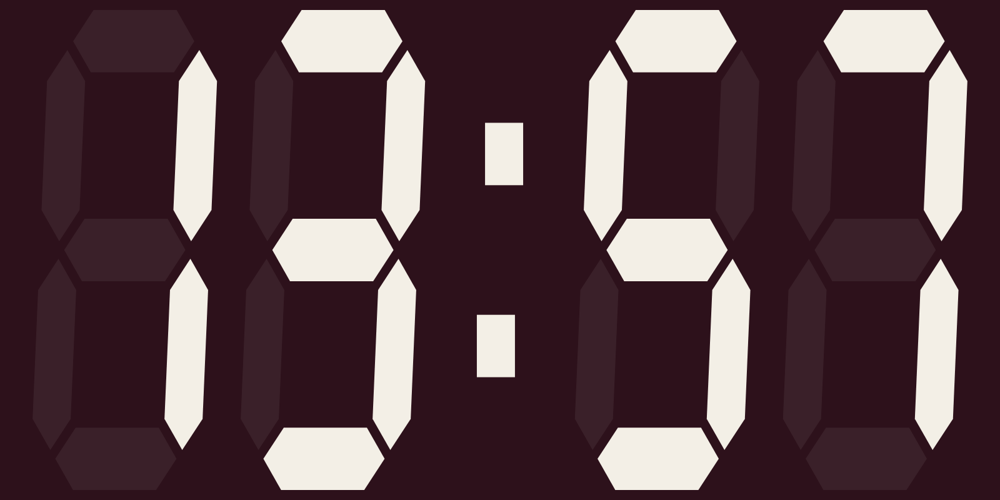

# Relais

Relais is an Android timer for performers. A **work** is a chain of countdowns: when one reaches zero, the next one starts by itself, each with its own background and digit colours. Works are kept in **worklists**, which play as set lists: a title screen before each work, and the next title as soon as a work ends. The digits are drawn as seven-segment LED figures and fill the whole screen, as in its sibling app [Élan](https://github.com/elnathproject/ELAN).

## Screenshots

<p>
  
  
  
  
</p>

From left: the worklists; editing a work; the title of a work, waiting for the pedal, with the head of the bar set to start from 20:00; the second countdown of the work, in its own colours.

<p>
  
</p>

## Features

- **Sequential countdowns.** Each work holds up to 99 countdowns, from one second to 999:59. At zero the next countdown starts without any input.
- **Colours per countdown.** Every countdown has its own background and digit colour, chosen freely or from ready-made pairs, so the sections of a work can be told apart at a glance.
- **Blinking in time.** When a new countdown begins, its digits blink for three seconds in step with the seconds: each new value appears lit at the instant it changes, so the count is never hidden.
- **Worklists as set lists.** Start a worklist and every work opens on its title, shown full screen and static until you start it. When the last countdown of a work ends, the title of the next work appears; after the last work, an end screen.
- **Start from any point.** On the title of a work, the coloured bar works like the progress bar of an audio player: tap or drag the head, or step it a second at a time, and Start begins from that point, for example from 0:31, in the colours of the countdown it falls in. Reset brings back the same point, to rehearse a passage again; the next work of a worklist starts from 0:00.
- **Single works.** Start a work on its own and it stops at 00:00 when its last countdown ends.
- **Foot pedal.** A Bluetooth page-turner pedal, like those used for PDF scores, controls the player. On a title, right starts the countdown. On a countdown, right pauses and resumes, left resets to the title. Arrow keys, Page Up/Down, Space and Enter are all recognised, so any pedal mode works, as does a Bluetooth keyboard.
- **Ordering.** Worklists, works and countdowns can be moved up and down; works and countdowns can be duplicated.
- **Import and export.** Each worklist, or the whole library, can be saved as a JSON file and imported on another device. Importing adds the worklists in the file to those already there.
- **Silent by default.** Sound starts off every time the player opens. Turn it on to get a double tone and a vibration at each change.
- **Screen stays on** for as long as the app is open.
- **Works offline.** The app does not request internet access and collects no data.

Time is always computed from the system clock rather than by counting ticks, so it stays accurate even if the phone slows the app down.

## For ensembles: web version

The `web/` folder holds a web version for a group of musicians: a conductor plays the worklists exported from the app on a password-protected page, and the performers follow the same screens full screen on their phones or tablets, by opening an address or scanning a QR code, with no app to install. All displays change countdown together. It runs on ordinary PHP web hosting; see [web/README.md](web/README.md).

## Exchange file

```json
{
  "format": "relais-worklists",
  "version": 1,
  "worklists": [
    { "name": "Worklist 1",
      "works": [
        { "name": "Work 1",
          "segments": [ { "s": 450, "bg": "#0d0f10", "fg": "#f2a541" },
                        { "s": 300, "bg": "#0b1a33", "fg": "#6fb7ff" } ] } ] }
  ]
}
```

`s` is the length in seconds, `bg` and `fg` the background and digit colours. Values out of range are corrected on import; a file without worklists is refused.

## Installing

Every change pushed to the `main` branch triggers an automatic build, which you can follow in the repository's **Actions** tab; the APK of each build is kept there as an artifact. Each version tagged `vX.Y.Z` also gets a release with `Relais.apk` on the **Releases** page.

To install it on your phone:

1. Download `Relais.apk` on the phone.
2. Open the downloaded file. The first time, Android asks you to allow installs from that source (your browser or file manager): allow it.
3. Google Play Protect may warn that the developer is unknown; choose to install anyway.

To update, install the new APK over the old one. If Android refuses because the signature differs, export your worklists first, uninstall the old version, install the new one and import them again: the worklists are stored inside the app and are lost when it is uninstalled.

## Project structure

- `app/src/main/assets/index.html`: the app itself, meaning the worklists, the editor, the player, the digit drawing and the timing logic. It also runs in a desktop or mobile browser for quick testing.
- `app/src/main/java/com/ciccarelli/relais/MainActivity.kt`: the Android window that hosts the page full screen, keeps the screen on, handles vibration, the back button and the system file picker for import and export, and opens external links in the browser.
- `app/src/main/AndroidManifest.xml`: name, icon, automatic rotation and permissions (vibration only).
- `.github/workflows/build.yml`: the automatic build on GitHub.
- `web/`: the web version for ensembles (conductor and displays), described in its own README.
- `docs/screenshots/`: the images of this page.
- `LICENSE`: the MIT License.


## Credits

Designed and built by Alessandro Ciccarelli (Elnath Project), [alessandrociccarelli.com](https://alessandrociccarelli.com). © 2026.

## License

Relais is released under the [MIT License](LICENSE).
